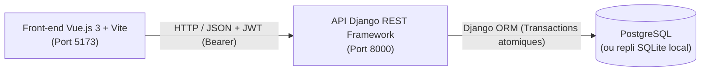

# Architecture technique — SmartRoute CM

## 1. Vue d'ensemble (3 couches)



- **Sécurité côté serveur** : l'authentification JWT (`SimpleJWT` : accès 30 min, rafraîchissement 24 h) et les permissions par rôle sont vérifiées dans les vues DRF, jamais uniquement dans Vue.js.
- **Format d'erreur uniforme (ENF-04)** : toute erreur HTTP (`400`, `401`, `403`, `404`, `422`) retourne :

```json
{
  "code": "CODE_ERREUR",
  "message": "Description lisible en français.",
  "details": {}
}
```

## 2. Décisions d'architecture validées (Section 9)

1. **Hypothèse H1 (ordre de visite)** : le gestionnaire fixe l'ordre des arrêts de la tournée ; Dijkstra calcule le chemin optimal entre chaque arrêt consécutif.
2. **Hypothèse H2 (orientation)** : chaque `TronconRoutier` est orienté (`origine -> destination`) ; `double_sens=True` crée l'arc inverse dans le graphe.
3. **Code erreur chemin inexistant (EF-13 / RG-02)** : HTTP `422` avec `"code": "AUCUN_ITINERAIRE"` et les identifiants/noms des points concernés dans `"details"`.
4. **Coefficients centralisés (RG-05)** : regroupés dans `backend/apps/itineraires/ponderation.py` (aucun cache réseau, RG-06).
5. **10e entité `CalculItineraire` (EF-15)** : persiste les résultats et l'instantané des étapes pour permettre la comparaison avant/après.

## 3. Modèle de données (10 entités)

| Application | Modèle | Contraintes & index clés |
| :--- | :--- | :--- |
| `accounts` | `Utilisateur` | `username` unique, `email` unique, `role` (`admin`, `gestionnaire`, `livreur`) |
| `reseau` | `PointRoutier` | `nom` unique |
| `reseau` | `TronconRoutier` | `distance_km > 0`, `duree_base_min > 0`, `origine != destination` |
| `flotte` | `Livreur` | `OneToOne(Utilisateur)` |
| `flotte` | `Vehicule` | `immatriculation_fictif` unique, `capacite_kg > 0` |
| `flotte` | `PointLivraison` | `quartier` et `repere` obligatoires, FK `PointRoutier` |
| `flotte` | `Colis` | `reference` unique, `poids_kg > 0` |
| `tournees` | `Tournee` | Index `(livreur, date)` |
| `tournees` | `EtapeTournee` | Unicité `(tournee, rang)` |
| `itineraires` | `CalculItineraire` | `donnees_fictives=True`, instantanés JSON des étapes et hypothèses |

## 4. Matrice des droits API

| Ressource / Action | Administrateur | Gestionnaire | Livreur |
| :--- | :---: | :---: | :---: |
| `/api/health/` | Public | Public | Public |
| Comptes et rôles | Gérer | — | Son profil (`/api/auth/me/`) |
| Réseau (points, tronçons) | Lire | Gérer, fermer/rouvrir | — |
| Véhicules, points de livraison, colis | Lire | Gérer | Ceux de ses tournées |
| Tournées et étapes | Lire | Créer, calculer, modifier | Uniquement les siennes |
| Calcul et comparaison d'itinéraires | — (historique lecture) | Exécuter | — |
| `/api/itineraires/points/` et `/api/itineraires/ponderation/` (lecture seule) | Lire | Lire | Lire |
| Tableau de bord | Lire | Lire | — |
