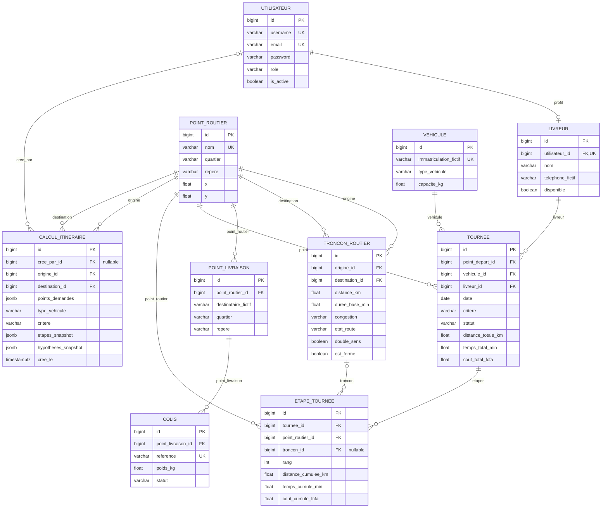

# Base de données — SmartRoute CM

> Schéma établi à partir des modèles Django et des migrations `0001_initial` du dépôt.
> Les types indiqués sont ceux de **PostgreSQL** (base cible `smartroute_cm`). En repli SQLite, les types diffèrent mais la structure reste la même.
> Toutes les données du projet sont **fictives**.

## 1. Vue d'ensemble

| Application | Modèle | Table | Rôle |
| :--- | :--- | :--- | :--- |
| `accounts` | `Utilisateur` | `accounts_utilisateur` | Comptes et rôles |
| `reseau` | `PointRoutier` | `reseau_pointroutier` | Nœuds du graphe routier |
| `reseau` | `TronconRoutier` | `reseau_tronconroutier` | Arcs du graphe routier |
| `flotte` | `Livreur` | `flotte_livreur` | Profil d'un livreur |
| `flotte` | `Vehicule` | `flotte_vehicule` | Véhicules |
| `flotte` | `PointLivraison` | `flotte_pointlivraison` | Adresses de livraison |
| `flotte` | `Colis` | `flotte_colis` | Colis à livrer |
| `tournees` | `Tournee` | `tournees_tournee` | Tournées planifiées |
| `tournees` | `EtapeTournee` | `tournees_etapetournee` | Étapes ordonnées d'une tournée |
| `itineraires` | `CalculItineraire` | `itineraires_calculitineraire` | Historique des calculs |

## 2. Diagramme entité-association



## 3. Dictionnaire de données

Chaque table a une clé primaire `id` de type `bigint`, générée automatiquement. Les colonnes sont `NOT NULL`, sauf mention « nullable ».

Les **valeurs par défaut** indiquées sont appliquées par Django, et non par PostgreSQL : une insertion en SQL direct doit les fournir.

### 3.1 `accounts_utilisateur`

Étend `AbstractUser` de Django.

| Colonne | Type | Contraintes / défaut | Description |
| :--- | :--- | :--- | :--- |
| `id` | `bigint` | PK | |
| `username` | `varchar(150)` | unique | Identifiant de connexion |
| `password` | `varchar(128)` | | Empreinte du mot de passe (jamais en clair avec les méthodes Django) |
| `email` | `varchar(254)` | unique | Adresse e-mail |
| `role` | `varchar(20)` | défaut `livreur` | `admin`, `gestionnaire`, `livreur` |
| `first_name` | `varchar(150)` | peut être vide | Prénom |
| `last_name` | `varchar(150)` | peut être vide | Nom |
| `is_superuser` | `boolean` | défaut `false` | Tous les droits Django |
| `is_staff` | `boolean` | défaut `false` | Accès à l'admin Django |
| `is_active` | `boolean` | défaut `true` | Compte actif |
| `last_login` | `timestamptz` | nullable | Dernière connexion |
| `date_joined` | `timestamptz` | défaut : maintenant | Date de création |

### 3.2 `reseau_pointroutier`

| Colonne | Type | Contraintes / défaut | Description |
| :--- | :--- | :--- | :--- |
| `id` | `bigint` | PK | |
| `nom` | `varchar(120)` | unique | Nom du point |
| `quartier` | `varchar(120)` | | Quartier |
| `repere` | `varchar(200)` | peut être vide | Point de repère |
| `x` | `double precision` | défaut `0.0` | Coordonnée X fictive |
| `y` | `double precision` | défaut `0.0` | Coordonnée Y fictive |
| `cree_le` | `timestamptz` | automatique | Date de création |

### 3.3 `reseau_tronconroutier`

| Colonne | Type | Contraintes / défaut | Description |
| :--- | :--- | :--- | :--- |
| `id` | `bigint` | PK | |
| `origine_id` | `bigint` | FK → `reseau_pointroutier` | Point d'origine |
| `destination_id` | `bigint` | FK → `reseau_pointroutier`, différent de `origine_id` | Point de destination |
| `distance_km` | `double precision` | `> 0` | Distance |
| `duree_base_min` | `double precision` | `> 0` | Durée sans pénalité |
| `congestion` | `varchar(20)` | défaut `fluide` | `fluide`, `moderee`, `forte` |
| `etat_route` | `varchar(20)` | défaut `bon` | `bon`, `degrade`, `tres_degrade`, `impraticable` |
| `praticable_moto` | `boolean` | défaut `true` | Accessible aux motos |
| `praticable_vehicule_leger` | `boolean` | défaut `true` | Accessible aux véhicules légers |
| `double_sens` | `boolean` | défaut `true` | Crée aussi l'arc inverse dans le graphe |
| `est_ferme` | `boolean` | défaut `false` | Tronçon fermé |
| `modifie_le` | `timestamptz` | automatique | Dernière modification |

Un tronçon à double sens occupe **une seule ligne**. L'arc inverse est construit en mémoire par le moteur.

### 3.4 `flotte_livreur`

| Colonne | Type | Contraintes / défaut | Description |
| :--- | :--- | :--- | :--- |
| `id` | `bigint` | PK | |
| `utilisateur_id` | `bigint` | FK → `accounts_utilisateur`, unique | Compte associé (relation 1–1) |
| `nom` | `varchar(120)` | | Nom complet fictif |
| `telephone_fictif` | `varchar(30)` | | Téléphone fictif |
| `disponible` | `boolean` | défaut `true` | Disponibilité |

### 3.5 `flotte_vehicule`

| Colonne | Type | Contraintes / défaut | Description |
| :--- | :--- | :--- | :--- |
| `id` | `bigint` | PK | |
| `immatriculation_fictif` | `varchar(30)` | unique | Immatriculation fictive |
| `type_vehicule` | `varchar(20)` | | `moto`, `vehicule_leger` |
| `capacite_kg` | `double precision` | `> 0` | Charge maximale |

### 3.6 `flotte_pointlivraison`

| Colonne | Type | Contraintes / défaut | Description |
| :--- | :--- | :--- | :--- |
| `id` | `bigint` | PK | |
| `destinataire_fictif` | `varchar(120)` | | Destinataire fictif |
| `quartier` | `varchar(120)` | obligatoire dans les formulaires | Quartier |
| `repere` | `varchar(200)` | obligatoire dans les formulaires | Point de repère |
| `point_routier_id` | `bigint` | FK → `reseau_pointroutier` | Nœud du graphe associé |

### 3.7 `flotte_colis`

| Colonne | Type | Contraintes / défaut | Description |
| :--- | :--- | :--- | :--- |
| `id` | `bigint` | PK | |
| `reference` | `varchar(50)` | unique | Référence |
| `poids_kg` | `double precision` | `> 0` | Poids |
| `statut` | `varchar(20)` | défaut `en_attente` | `en_attente`, `planifie`, `en_cours`, `livre` |
| `point_livraison_id` | `bigint` | FK → `flotte_pointlivraison` | Lieu de livraison |

### 3.8 `tournees_tournee`

| Colonne | Type | Contraintes / défaut | Description |
| :--- | :--- | :--- | :--- |
| `id` | `bigint` | PK | |
| `date` | `date` | | Date de la tournée |
| `point_depart_id` | `bigint` | FK → `reseau_pointroutier` | Départ |
| `vehicule_id` | `bigint` | FK → `flotte_vehicule` | Véhicule |
| `livreur_id` | `bigint` | FK → `flotte_livreur` | Livreur |
| `critere` | `varchar(20)` | défaut `distance` | `distance`, `temps`, `cout` |
| `statut` | `varchar(20)` | défaut `planifiee` | `planifiee`, `en_cours`, `terminee`, `annulee` |
| `distance_totale_km` | `double precision` | défaut `0.0` | Total distance |
| `temps_total_min` | `double precision` | défaut `0.0` | Total temps estimé |
| `cout_total_fcfa` | `double precision` | défaut `0.0` | Total coût estimé |
| `cree_le` | `timestamptz` | automatique | Date de création |

### 3.9 `tournees_etapetournee`

| Colonne | Type | Contraintes / défaut | Description |
| :--- | :--- | :--- | :--- |
| `id` | `bigint` | PK | |
| `tournee_id` | `bigint` | FK → `tournees_tournee` | Tournée |
| `rang` | `integer` | `>= 0`, unique avec `tournee_id` | Ordre de visite |
| `point_routier_id` | `bigint` | FK → `reseau_pointroutier` | Point visité |
| `troncon_id` | `bigint` | FK → `reseau_tronconroutier`, nullable | Tronçon emprunté |
| `distance_cumulee_km` | `double precision` | défaut `0.0` | Distance cumulée |
| `temps_cumule_min` | `double precision` | défaut `0.0` | Temps cumulé |
| `cout_cumule_fcfa` | `double precision` | défaut `0.0` | Coût cumulé |

### 3.10 `itineraires_calculitineraire`

| Colonne | Type | Contraintes / défaut | Description |
| :--- | :--- | :--- | :--- |
| `id` | `bigint` | PK | |
| `libelle` | `varchar(160)` | peut être vide | Nom du scénario |
| `cree_par_id` | `bigint` | FK → `accounts_utilisateur`, nullable | Auteur du calcul |
| `origine_id` | `bigint` | FK → `reseau_pointroutier` | Premier point demandé |
| `destination_id` | `bigint` | FK → `reseau_pointroutier` | Dernier point demandé |
| `points_demandes` | `jsonb` | défaut `[]` | Liste ordonnée des identifiants de points |
| `type_vehicule` | `varchar(20)` | | `moto`, `vehicule_leger` |
| `critere` | `varchar(20)` | | `distance`, `temps`, `cout` |
| `distance_totale_km` | `double precision` | | Total distance |
| `temps_total_min` | `double precision` | | Total temps estimé |
| `cout_total_fcfa` | `double precision` | | Total coût estimé |
| `etapes_snapshot` | `jsonb` | défaut `[]` | Copie des étapes au moment du calcul |
| `hypotheses_snapshot` | `jsonb` | défaut `{}` | Copie des formules et coefficients utilisés |
| `donnees_fictives` | `boolean` | défaut `true` | Marqueur de données fictives |
| `cree_le` | `timestamptz` | automatique | Date du calcul |

#### Structure des colonnes JSON

`points_demandes` (les valeurs ci-dessous sont des exemples) :

```json
[1, 4, 7]
```

Un élément de `etapes_snapshot` :

```json
{
  "rang": 1,
  "troncon_id": 3,
  "origine_id": 1,
  "origine_nom": "Point A",
  "origine_quartier": "Quartier A",
  "origine_repere": "Repère A",
  "destination_id": 4,
  "destination_nom": "Point B",
  "destination_quartier": "Quartier B",
  "destination_repere": "Repère B",
  "distance_km": 2.0,
  "temps_estime_min": 6.0,
  "cout_estime_fcfa": 250.0,
  "distance_cumulee_km": 2.0,
  "temps_cumule_min": 6.0,
  "cout_cumule_fcfa": 250.0,
  "congestion": "fluide",
  "etat_route": "bon",
  "sens_inverse": false
}
```

Clés de `hypotheses_snapshot` :

- `donnees_fictives`
- `avertissement`
- `formules` : `temps_estime_min`, `cout_estime_fcfa`
- `coefficients` : `k_congestion`, `k_etat`, `cout_km_fcfa`, `cout_min_fcfa`, `penalite_etat_km_fcfa`

## 4. Contraintes et index

### Contraintes nommées

| Nom | Table | Règle |
| :--- | :--- | :--- |
| `troncon_distance_gt_0` | `reseau_tronconroutier` | `distance_km > 0` |
| `troncon_duree_gt_0` | `reseau_tronconroutier` | `duree_base_min > 0` |
| `troncon_origine_diff_destination` | `reseau_tronconroutier` | `origine_id <> destination_id` |
| `vehicule_capacite_gt_0` | `flotte_vehicule` | `capacite_kg > 0` |
| `colis_poids_gt_0` | `flotte_colis` | `poids_kg > 0` |
| `etape_tournee_rang_unique` | `tournees_etapetournee` | `(tournee_id, rang)` unique |

Les listes de valeurs (`role`, `congestion`, `statut`, etc.) sont validées par Django (formulaires, sérialiseurs, `full_clean()`). **Aucune contrainte SQL** ne les impose, et `save()` seul ne les vérifie pas.

### Index

- Un index sur chaque clé primaire et chaque colonne unique.
- Un index créé automatiquement par Django sur chaque clé étrangère.
- Un index composé `tournee_livreur_date_idx` sur `tournees_tournee (livreur_id, date)`.

## 5. Comportement à la suppression

Ces règles sont appliquées par **l'ORM Django**. Une suppression en SQL direct ne les déclenche pas : les clés étrangères la bloquent simplement s'il reste des références.

| Élément supprimé | Élément lié | Règle | Effet |
| :--- | :--- | :--- | :--- |
| `PointRoutier` | `TronconRoutier` (origine, destination) | `CASCADE` | Les tronçons sont supprimés |
| `PointRoutier` | `PointLivraison`, `Tournee`, `EtapeTournee`, `CalculItineraire` | `PROTECT` | Suppression refusée |
| `TronconRoutier` | `EtapeTournee` | `SET_NULL` | `troncon_id` devient vide |
| `Utilisateur` | `Livreur` | `CASCADE` | Le profil est supprimé, sauf si une tournée le protège (la suppression est alors refusée) |
| `Utilisateur` | `CalculItineraire` | `SET_NULL` | `cree_par_id` devient vide |
| `Livreur`, `Vehicule` | `Tournee` | `PROTECT` | Suppression refusée |
| `Tournee` | `EtapeTournee` | `CASCADE` | Les étapes sont supprimées |
| `PointLivraison` | `Colis` | `PROTECT` | Suppression refusée |

## 6. Tables techniques de Django

Elles sont créées par `python manage.py migrate`, en plus des 10 tables métier.

| Table | Rôle |
| :--- | :--- |
| `accounts_utilisateur_groups` | Liaison utilisateurs ↔ groupes |
| `accounts_utilisateur_user_permissions` | Liaison utilisateurs ↔ permissions |
| `auth_group` | Groupes |
| `auth_permission` | Permissions |
| `auth_group_permissions` | Liaison groupes ↔ permissions |
| `django_content_type` | Registre des modèles |
| `django_admin_log` | Journal de l'admin Django |
| `django_session` | Sessions |
| `django_migrations` | Historique des migrations |

## 7. Points à discuter en équipe

Ces points décrivent des limites du schéma actuel. **Aucun n'a été modifié dans le code.**

1. **Aucun lien direct entre une tournée et ses colis.** Ni `Tournee` ni `EtapeTournee` ne référence `Colis` ou `PointLivraison`. Le point routier d'une étape ne suffit pas : plusieurs points de livraison et colis peuvent partager le même. On ne peut donc pas savoir de façon fiable quels colis une tournée transporte, ce qui est nécessaire pour comparer leur poids total à `capacite_kg` et pour montrer au livreur ses colis. Pistes : une clé étrangère nullable `tournee` sur `Colis` (simple, mais sans historique des réaffectations), ou une table de liaison `Tournee` ↔ `Colis`. À décider avec les responsables des modules `flotte` et `tournees`.
2. **Tronçons en double possibles.** Aucune unicité ne porte sur `(origine_id, destination_id)`. C'est utile si deux routes distinctes relient les mêmes points, mais cela permet aussi les doublons accidentels.
3. **Rôle et profil livreur non liés en base.** Un compte `gestionnaire` pourrait recevoir un profil `Livreur`. Ce contrôle doit être fait dans l'application.
4. **Colonnes JSON sans intégrité référentielle.** Les identifiants dans `points_demandes` et `etapes_snapshot` ne sont pas des clés étrangères. C'est cohérent pour un instantané historique, mais le recalcul peut échouer si un point intermédiaire a été supprimé.
